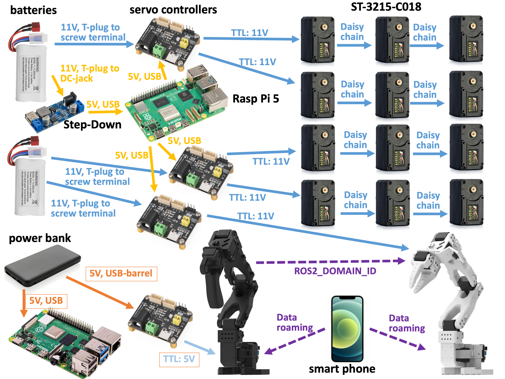

# CubicDoggo 14A: Homemade 12-DOF 4-Legged Robot Recipe with 6-DOF Arm
Cubic Doggo 14A Googboi is based on [Cubic Doggo 07B Wouf](https://github.com/SphericalCowww/CubicDoggo_14A), incorporating an [SO-101 arm](https://huggingface.co/docs/lerobot/en/so101). The robot is the simplest Cubic Doggo built for the [Tag of Flag](https://github.com/SphericalCowww/tag_of_flag) game.

Untethered remote control

## Ingredients

### 3D printing

The 3D printer model Creality K1C is used with the OrcaSlicer, but as long as it can print PLA+. All the FreeCAD files can be found here: <a href="https://github.com/SphericalCowww/CubicDoggo_14A/tree/main/src/my_robot_description/mesh/CADv2_ST-3215-C018">link</a>.

### Hardware 

| device | models | count | specification |
| - | - | - | - |
| servo motor | Feetech <a href="https://eckstein-shop.de/feetech-st-3215-c018-servo-en">ST-3215-C018</a>, [12 at once](https://de.aliexpress.com/item/1005012684461308.html) | 18 | Max stall torque: 3.0 N*m (at 12.0V, 2.7A) and weighs 55g |
| vitual servo motor | Feetech <a href="https://www.juxitech.com/products/feetech-serial-bus-servo-sts3215-scs0009?variant=53054355603765">STS3215-C066</a> | 6 | No torque, only for sensing |
| driver board | <a href="https://eckstein-shop.de/WaveShare-Serial-Bus-Servo-Driver-Board-for-ST-SC-Serial-Bus-Servos-EN">servo driver</a> | 4 | Ccontrol and power the servos in daisy chain |
| onboard computer | Raspberry Pi 5 | 1 | For running just IK, 4 GB RAM is sufficient; Pi 4 could be good enough as long as ROS2 Jazzy can be installed | 
| controller computer | Raspberry Pi 4 | 1 | For running the SO-101 controller, a 1GB Ram with swaps is sufficient | 
| DC-DC step-down converter | Hailege <a href="https://www.amazon.de/Hailege-Module-Step-Down-Supply-Converter/dp/B07XFMMY1F">24V/12V to 5V/5A</a> | 1 | USB Port port to Raspberry Pi,  DC 5.5mm x 2.5mm Male to battery | 
| battery | ZYGY <a href="https://www.amazon.de/dp/B0BB6RMM5Q">11.1V 2000mAh</a> | 2 | They already include protection. Need Charger. Need adapters for: T-plug => XT60 Male => DC 5.5mm x 2.5mm Male. Also recommend [toggle switches](https://www.amazon.de/-/en/gp/product/B0CX8TRQ35) to be soldered on the T-plugs  | 
| power bank | INIU <a href="https://www.amazon.de/dp/B0DCYR5VNR?ref=ppx_yo2ov_dt_b_fed_asin_title">5V 45W</a> | 1 | Like any 5V power bank with > 30W would be sufficient | 
| capacitor | 1000uF | 3 | rating 25V or higher | 
| bearings | M3 bearing+<a href="https://www.amazon.de/dp/B01M2ZCLKX">spacer</a>, threaded rod, rod-end bearing | 8, 4, 4, 4 | rod length of 60mm to match the leg length; other dimensions can be accomodated by modifying the CAD |
| bolts and nuts | | | M3 screws are used throughout, except where required to accommodate the servos and electronic boards; use locknuts |
| locking washers | [M3](https://www.amazon.de/dp/B09SCQV81D) | | use in case when locknuts are not available; use it along side regular washer: 3D-printed surface => regular washer => locking washer (convex side away from the surface) => bolt |

Other than the M3 screws (12mm, 16mm, 30mm), one specific requirement is the M2 self-tapping screws, specific to 10 mm length given 6mm padding, for the servos. Note that the length matters a lot; a screw 1 mm too long can already damage the servo!

### Power system

  * **Soldering requirement:** T-plugs are soldered to the bottom of the screw terminal of the driver boards.
  * **Soldering recommendation:** Add a toggle switch to each of the T-plugs between the driver board and the battery because the boards don't have power switches. Look for 12V, 20A-rated toggle switches.
  * Power the servo driver board with the screw terminal to handle ~16 amp current draw. Insert a 1000uF capacitor between the rail and ground with the correct polarity (shown in the right photo)
  * Also, in the right photo, the table is covered by a fire blanket in case of electrical shortages/high current during the testing stage
  * The ground between the 3 driver boards should be shared when they are all connected to the Raspberry Pi via USB
  * Power the Raspberry Pi via a ~12V-to-5V DC-DC converter. Don't forget to put Kapton tape to insulate the two boards
  * A 5V power supply is sufficient to power the Raspberry Pi 4 and the SO-101 leader. Remember to get a USB-barrel converter for the SO-101 leader
  * For the remote control, the data roaming in the left figure is technically to the Raspberry Pi's

  

## Running SO-101 arms

### Setting up SO-101 using LeRobot software

Note that for this setup, the leader arms are assumed to use virtual servos, such as STS3215-C066 (or WaveShare ST3215 (SE)), with 7.2 V grading (powered by a 5 V supply). 

The servo IDs are 6-1 from top to bottom. Remember to always put on the PLA holder for servo 5 and connect both wires before any other part, as the wires will otherwise be extremely difficult to access afterwards. Then install the arms following [HuggingFace](https://huggingface.co/docs/lerobot/en/so101).

Plug the driver board into the Raspberry Pi:

    sudo dmesg | tail -30
    ls -l /dev/ttyACM*                      # or whatever connection is found
    sudo usermod -aG dialout $USER
    sudo reboot

Install,

    sudo apt install python3.12-venv libevdev-dev libgz-cmake3-dev ffmpeg

Set up the Python environment to install [LeRobot](https://github.com/huggingface/lerobot),

    cd CubicDoggo_14A/
    cd ..
    python3 -m venv CubicDoggo_14A_env
    source CubicDoggo_14A_env/bin/activate
    pip install --upgrade pip jinja2 pyyaml typeguard setuptools wheel
    git clone https://github.com/huggingface/lerobot.git
    cd lerobot
    pip install -e .
    pip install -e ".[feetech]"

Follow the calibration steps for the follower (see also [YouTube](https://www.youtube.com/watch?v=Nhfda8h7e2I)),

    # plug in the driver board
    lerobot-find-port
    # unplug the driver board
    ## The port of this MotorsBus is '/dev/ttyACM0'
    # plug in the driver board
    ls -l /dev/serial/by-id/
    ## ... usb-1a86_USB_Single_Serial_5B8E112477-if00 -> ../../ttyACM0
    lerobot-setup-motors --robot.type=so101_follower --robot.port=/dev/serial/by-id/usb-1a86_USB_Single_Serial_5B8E112477-if00
    # Connecting the servos from top to bottom independently to the driver board one-by-one, following the instructions
    ## ... 'shoulder_pan' motor id set to 1
    # After completion, connect all servos in a daisy chain 
    lerobot-calibrate --robot.type=so101_follower --robot.port=/dev/serial/by-id/usb-1a86_USB_Single_Serial_5B8E112477-if00 --robot.id=my_follower
    # Follow the instructions

For the leader, while 5V is completely sufficient for operation, calibration sometimes needs higher voltage,

    ls -l /dev/serial/by-id/
    ## ... usb-1a86_USB_Single_Serial_5C93152513-if00 -> ../../ttyACM0
    lerobot-setup-motors --teleop.type=so101_leader --teleop.port=/dev/serial/by-id/usb-1a86_USB_Single_Serial_5C93152513-if00
    # ...
    lerobot-calibrate --teleop.type=so101_leader --teleop.port=/dev/serial/by-id/usb-1a86_USB_Single_Serial_5C93152513-if00 --teleop.id=my_leader

Once everything is done,

    deactivate

### Running SO-101 on ROS

Requirement: installing ROS2 Jazzy on a Raspberry Pi according to [GitHub](https://github.com/SphericalCowww/ROS_init_practice).

Note that although it is not needed in this setup, ``so101_ros2`` does require Gazebo, so don't forget to install it,

    cd CubicDoggo_14A/
    cd ..
    source CubicDoggo_14A_env/bin/activate
    export 
    for dir in /opt/ros/jazzy/opt/gz_*_vendor; do if [ -d "$dir" ]; then export CMAKE_PREFIX_PATH="$dir:$CMAKE_PREFIX_PATH"; fi; done
    pip install catkin_pkg 
    mkdir so101_ros2
    cd so101_ros2
    git clone https://github.com/adoodevv/so101_ros2.git
    mv so101_ros2 src
    cp ../CubicDoggo_14A/so101_ros2/src/so101_bringup/launch/so101_real_moveit_2devices.launch.py src/so101_bringup/launch/
    sudo rosdep init
    rosdep update
    rosdep install --from-paths src --ignore-src -r -y
    
The following is for debugging on a Raspberry Pi 4 with 1 Gb of RAM

    sudo fallocate -l 4G /swapfile
    sudo chmod 600 /swapfile
    sudo mkswap /swapfile
    sudo swapon /swapfile
    free -h                 # check if 4 Gb more RAM
    CMAKE_BUILD_PARALLEL_LEVEL=1 MAKEFLAGS="-j1" colcon build --symlink-install --executor sequential --event-handlers console_direct+ status-
    source install/setup.bash

For Raspberry Pi 5 with >4 Gb RAM:

    colcon build --symlink-install --executor sequential
    source install/setup.bash

Connect both driver boards and test out the calibration files, 

    ros2 run so101_hardware so101_hardware_check --port /dev/serial/by-id/usb-1a86_USB_Single_Serial_5B8E112477-if00 --calibration ~/.cache/huggingface/lerobot/calibration/robots/so_follower/my_follower.json
    ros2 run so101_hardware so101_hardware_check --port /dev/serial/by-id/usb-1a86_USB_Single_Serial_5C93152513-if00 --calibration ~/.cache/huggingface/lerobot/calibration/teleoperators/so_leader/my_leader.json

Then launch the arms,

    # For no torque with rViz
    ros2 launch so101_bringup so101_real_moveit.launch.py port:=/dev/serial/by-id/usb-1a86_USB_Single_Serial_5B8E112477-if00 read_only:=true
    # For powered without rViz
    ros2 launch so101_bringup so101_real_moveit.launch.py port:=/dev/serial/by-id/usb-1a86_USB_Single_Serial_5B8E112477-if00 use_rviz:=false 
    # For teleop
    ros2 launch so101_bringup so101_teleop.launch.py port:=/dev/serial/by-id/usb-1a86_USB_Single_Serial_5B8E112477-if00 leader_port:=/dev/serial/by-id/usb-1a86_USB_Single_Serial_5C93152513-if00 use_rviz:=false 

Note that if the arm has trouble connecting all servos, try turning down the communication to 50 Hz,

    vim src/so101_moveit_config/config/so101/ros2_controllers.yaml
    # update_rate: 50
    colcon build

### Running SO-101 on ROS with leader and follower on separate devices

On both devices, add,
    
    vim ~/.bashrc
    # export ROS_DOMAIN_ID=141
    source ~/.bashrc

Test discovery, as long as they are on the same network,

    sudo apt install ros-jazzy-demo-nodes-cpp
    # on leader device
    ros2 run demo_nodes_cpp talker
    # on follower device
    ros2 run demo_nodes_cpp listener

On both devices,

    cd CubicDoggo_14A
    cp ../CubicDoggo_14A/so101_ros2/src/so101_bringup/launch/so101_real_moveit_2devices.launch.py ../so101_ros2/src/so101_bringup/launch/so101_real_moveit_2devices.launch.py
    cd ../so101_ros2
    colcon build

Then, to run the teleoperation,

    # on leader device
    ros2 launch so101_bringup so101_real_moveit_2devices.launch.py leader_only:=true leader_port:=/dev/serial/by-id/usb-1a86_USB_Single_Serial_5C93152513-if00 leader_id:=my_leader use_rviz:=false 
    # on follower device
    ros2 node list
    ros2 launch so101_bringup so101_real_moveit_2devices.launch.py teleop:=true port:=/dev/serial/by-id/usb-1a86_USB_Single_Serial_5B8E112477-if00 follower_id:=my_follower use_rviz:=false 

Check if the domain is properly followed; do either of the following while running the code:

    sudo cat /proc/$(pgrep -f '/joy/joy_node' | head -n 1)/environ | tr '\0' '\n' | grep -E 'ROS_DOMAIN_ID|ROS_AUTOMATIC_DISCOVERY_RANGE'
    sudo cat /proc/$(pgrep -f '/so101_hardware/so101_leader' | head -n 1)/environ | tr '\0' '\n' | grep -E 'ROS_DOMAIN_ID|ROS_AUTOMATIC_DISCOVERY_RANGE'

#### Remote control setup via data roaming hotspot from a smartphone

This is for a terminal-only Raspberry Pi Ubuntu installation to connect to the hotspot on a smartphone. Since it's network related, try not doing the following over ``ssh``,

    sudo wpa_cli -i wlan0 scan
    sleep 3
    sudo wpa_cli -i wlan0 scan_results
    sudo vim /etc/netplan/99-wifi.yaml
    ##########################################################
    network:
      version: 2
      renderer: networkd
      wifis:
        wlan0:
          dhcp4: true
          access-points:
            "wifi_XXX":
              password: "wifi_password_XXX"
            "hotspot_XXX":
              password: "hotspot_password_XXX"
    ##########################################################
    sudo chmod 600 /etc/netplan/99-wifi.yaml
    sudo netplan generate
    sudo netplan apply
    networkctl status wlan0
    sudo wpa_cli -i wlan0 list_networks
    sudo wpa_cli -i wlan0 select_network 1         # for switching

#### Alternative to remote control: Bluetooth setup (WARNING: HIGH LATENCY ISSUES)

On both devices,

    sudo apt install network-manager bluez bluez-tools 
    sudo systemctl enable --now bluetooth
    bluetoothctl show

To start pairing, on the leader device,

    bluetoothctl
    power on
    agent on
    default-agent
    discoverable on
    pairable on
    # do not exit

Then, on the follower device, 

    bluetoothctl
    power on
    agent on
    default-agent
    scan on
    # Pair immediately after seeing
    # [bluetooth]# [NEW] Device 98:FE:54:75:C3:C9 cubicgoogboi_controller-desktop
    pair 98:FE:54:75:C3:C9
    # yes
    trust 98:FE:54:75:C3:C9
    connect 98:FE:54:75:C3:C9
    # yes on the follower side
    exit                          # on both sides 
    # For debugging:
    ## bluetoothctl info 98:FE:54:75:C3:C9                       
    ## sudo journalctl -u bluetooth -n 80 --no-pager   

Then create a Bluetooth PAN connection on the leader device as the server:

    nmcli --version
    ip -br addr
    sudo nmcli connection add type bluetooth con-name cubicgoogboi-server ifname btnap0 bluetooth.type nap ipv4.method shared ipv6.method disabled
    sudo nmcli connection up cubicgoogboi-server
    # sudo nmcli connection down cubicgoogboi-server                               # if needed
    # sudo nmcli connection delete cubicgoogboi-server                             # if needed
    # sudo systemctl restart NetworkManager                                        # if needed
    # nmcli device status
    ip -br addr
    bluetoothctl show | grep -i "NAP"
    # UUID: NAP                       (00001116-0000-1000-8000-00805f9b34fb)
    sudo bt-agent -c NoInputNoOutput                   # and keep the agent on

Then create a Bluetooth PAN connection on the follower device as the client:

    nmcli --version
    ip -br addr
    # NOTE: manually assign Bluetooth PAN IP address
    sudo nmcli connection add type bluetooth con-name cubicgoogboi-client ifname "*" bluetooth.type panu bluetooth.bdaddr 98:FE:54:75:C3:C9 ipv4.method manual ipv4.addresses 10.42.0.141/24 ipv4.gateway "" ipv6.method disabled
    sudo nmcli connection up cubicgoogboi-client
    # sudo nmcli connection down cubicgoogboi-client                                  # if needed
    # sudo nmcli connection delete cubicgoogboi-client                                # if needed
    # sudo systemctl restart NetworkManager                                           # if needed
    # nmcli device status
    ip -br addr
    ping -c 4 10.42.0.1
    bluetoothctl show
    bluetoothctl info 98:FE:54:75:C3:C9
    sudo sdptool browse 98:FE:54:75:C3:C9 | grep -i -A 10 "Network Access"         # need to find some lines

To automatically start the connection, on the leader device:

    sudo nmcli connection modify cubicgoogboi-server connection.autoconnect yes
    nmcli -f NAME,AUTOCONNECT connection show
    sudo vim /etc/systemd/system/bluetooth-agent.service
    # Add the following:
    ##########################################################
    [Unit]
    Description=Persistent Bluetooth Authorization Agent
    Requires=bluetooth.service
    After=bluetooth.service
    
    [Service]
    Type=simple
    ExecStart=/usr/bin/bt-agent -c NoInputNoOutput
    Restart=always
    RestartSec=3
    TimeoutStopSec=5
    
    [Install]
    WantedBy=multi-user.target
    ##########################################################
    sudo systemctl enable bluetooth-agent.service
    sudo systemctl daemon-reload
    sudo systemctl restart bluetooth-agent.service
    ## systemctl status bluetooth-agent.service --no-pager    # for debugging
    ## journalctl -u bluetooth-agent.service -f
    # Moreover, export the following in .bashrc for ROS2 to communicate
    ##########################################################
    export CYCLONEDDS_URI='
    <CycloneDDS>
        <Domain>
          <General>
            <Interfaces>
              <NetworkInterface name="btnap0"/>
            </Interfaces>
            <AllowMulticast>false</AllowMulticast>
          </General>
          <Discovery>
            <Peers>
              <Peer Address="10.42.0.141"/>
            </Peers>
          </Discovery>
        </Domain>
    </CycloneDDS>'
    ##########################################################

And on the follower device:

    sudo nmcli connection modify cubicgoogboi-client connection.autoconnect yes connection.autoconnect-retries 0
    nmcli -f NAME,AUTOCONNECT connection show

To confirm connections, on the leader device:

    nmcli device status
    ip -br addr | grep btnap0
    # sudo nmcli connection up cubicgoogboi-server          # if not up

And on the follower device:

    nmcli device status
    ip -br addr | grep bnep0
    # sudo nmcli connection up cubicgoogboi-client          # if not up
    ping -c 4 10.42.0.1

Also, with this Bluetooth setup, always turn on the controller first!

## Running servos for the legs

### Testing with STServo Python library

Plug in the device:

    dmesg | tail -30
    ls -l /dev/ttyACM*                      # or whatever connection is found
    sudo usermod -aG dialout $USER
    sudo reboot

Download ``ST/SC serial bus servo control library (Python)`` from <a href="https://www.waveshare.com/wiki/Bus_Servo_Adapter_(A)">link</a>, put it under ``CubicDoggo_14A/st3215test/``.

    cd CubicDoggo_14A/
    cd ..
    python3 -m venv CubicDoggo_14A_env
    source CubicDoggo_14A_env/bin/activate
    cd CubicDoggo_14A/st3215test/
    unzip STServo_Python.zip
    pip install -r STServo_Python/requirements.txt
    cp -r STServo_Python/stservo-env/scservo_sdk .
    cp STServo_Python/stservo-env/sms_sts/read_write.py test.py    
    vim test.py
    # DEVICENAME = '/dev/ttyACM0'    # change to the port for the controller
    python3 test.py                  # or spinTest_1servo.py in the code

### Initializing servos in ROS with STServo library

Download ``ST/SC serial bus servo control library (Linux)`` from <a href="https://www.waveshare.com/wiki/Bus_Servo_Adapter_(A)">link</a>, expand it under ``CubicDoggo_14A/src/my_toolbox_scs_workbench/`` and replace ``src/my_toolbox_scs_workbench/SCServo_Linux/SCServo_Linux_220329/SCServo_Linux/CMakeLists.txt``.

    cd CubicDoggo_14A/
    colcon build --packages-select my_toolbox_scs_workbench --cmake-clean-first
    source install/setup.bash

To change the servo ID and initialize the servo, connect only 1 controller and 1 servo,

    vim CubicDoggo_14A/src/my_toolbox_scs_workbench/src/scanUpdateID_zeroing.cpp
    # Modify targetID, EEPROM change is only enabled when ID changes 
    # Modify pos_offset_quick, when settled, set pos_offset_quick=0 and set pos_offset accordingly into the EEPROM
    ros2 run my_toolbox_scs_workbench scanUpdateID_zeroing

Or connect all the servos with IDs listed, update all their EEPROM at once with

    ros2 run my_toolbox_scs_workbench scanUpdateAll_zeroing

**WARNING: DO NOT CTRL-C FOR THESE EEPROM PROCESSES**

Remember to tune and record the pos_offset to set the servo at the correct default position (halfway between minimal and maximal ticks).

To test 1 servo again, do,

    ros2 run my_toolbox_scs_workbench testSpin_servo1

To test 2 servos with 2 controllers, or 3 servos daisy-chained, redo the connection accordingly and do,

    ros2 run my_toolbox_scs_workbench testSpin_servo2controller2
    ros2 run my_toolbox_scs_workbench testSpin_servo3

 

**NOTE:** Record the ``pos_offset`` for each servo independently such that each of their default position is finely aligned.

**NOTE:** ``sts_wb.writeByte``requires unlocking the EEPROM; do NOT do this firmware change too frequently, otherwise it can cause corruption.

## Running a leg

Once again, for the M2 self-tapping screws, use screws with 10 mm length, given 6mm padding from the blue holder part; the length matters a lot, screw in 1 mm too much can already damage the servo! Also, don't forget the center M3 screw when connecting the blue holder part to the servo shaft; this significantly increases the leg stability.

For an initial rViz check:

    cd CubicDoggo_14A/
    colcon build
    source install/setup.bash
    ros2 launch my_robot_description cubic_leg1.rviz.launch.xacro.py

For the lifecycle that controls 1 leg:

    # if hardware is not yet connected, use the mock engine
    ## vim CubicDoggo_14A/src/my_robot_description/urdf/cubic_leg1.ros2_control.xacro
    ### uncomment: <!--plugin>mock_components/GenericSystem</plugin-->
    ### comment out: <plugin>cubic_doggo_namespace/HardwareInterfaceST3215_cubic_leg1</plugin>
    cd CubicDoggo_14A/
    colcon build
    source install/setup.bash
    ros2 launch my_robot_bringup cubic_leg1.with_lifecycle.launch.py
    # if no config loaded
    ## Fixed Frame: base_link
    ## Add: RobotModel
    ## RobotModel: Description Topic: /robot_description
    # on another terminal
    ros2 topic pub -1 /leg1_set_named example_interfaces/msg/String "{data: "pose1"}"
    ros2 topic pub -1 /leg1_set_joint example_interfaces/msg/Float64MultiArray "{data: [3.14, 3.14, 3.14]}"
    # record read position 
    ros2 topic pub -1 /leg1_set_pose my_robot_interface/msg/CubicLeg1PoseTarget "{x: 0.09, y: 0.14, z: 0.14, use_cartesian_path: false}"
    ros2 service call /leg1_walk_toggle std_srvs/srv/SetBool "{data: true}"     # IK very easy to fail
    ros2 service call /leg1_walk_toggle std_srvs/srv/SetBool "{data: false}"
    ros2 lifecycle set /cubic_leg1_lifecycle deactivate
    ros2 lifecycle set /cubic_leg1_lifecycle shutdown

### Testing the joystick controller:

    ls /dev/input/js*
    # output: /dev/input/js0
    # otherwise do: sudo jstest /dev/input/js0
    ros2 run joy joy_enumerate_devices
    # if no device found
    sudo usermod -aG input $USER
    sudo reboot

    cd CubicDoggo_14A
    colcon build
    source install/setup.bash
    ros2 run joy joy_node
    # on another terminal
    ros2 run my_robot_controller cubic_doggo_joy_control
    # on yet another terminal
    ros2 node info /cubic_doggo_joy_control    
    ros2 topic info /joy --verbose
    ros2 topic echo /joy

### Checking Raspberry Pi power

    for d in /sys/class/hwmon/hwmon*; do echo -n "$d: "; cat "$d/name"; done   # find the correct path for power alarm
    # update CubicDoggo_14A/src/my_robot_bringup/launch/cubic_doggo.with_lifecycle.launch.py
    echo timer | sudo tee /sys/class/leds/ACT/trigger                          # trigger LED first
    sudo chmod -R 777 /sys/class/leds/ACT/                                     # enable LED to indicate battery condition
    sudo chmod -R 777 /sys/class/hwmon/hwmon*/                                 # enable reading of power alarm/voltage
    # test the node 
    echo 0 > /tmp/fake_alarm                                                   # create a fake alarm by
    ros2 run my_robot_peripheral rasp_pi_peripheral_node --ros-args -p alarm_path:=/tmp/fake_alarm
    echo 1 > /tmp/fake_alarm                                                   # create a fake alarm by

## Running the full robot

To check the rViz of the robot:

    cd CubicDoggo_14A/
    colcon build
    source install/setup.bash
    ros2 launch my_robot_description cubic_doggo.rviz.launch.xacro.py

The full robot uses two driver boards, and ``ls -l /dev/ttyACM*`` is randomly assigned, so it is not reliable. Instead, check,

    ls -l /dev/serial/by-id/
    vim src/my_robot_description/urdf/cubic_doggo.ros2_control.xacro
    # Update the configuration to match the driver boards' unique IDs, for example,
    ## <param name="port_name_front">/dev/serial/by-id/usb-1a86_USB_Single_Serial_5B14033936-if00</param>
    ## <param name="port_name_back"> /dev/serial/by-id/usb-1a86_USB_Single_Serial_5B14029539-if00</param>
    colcon build

To run the full robot, power on the driver boards and do:

    ros2 launch my_robot_bringup cubic_doggo.with_lifecycle.launch.py
    # on another terminal
    ros2 topic pub -1 /leg_set_named example_interfaces/msg/String "{data: "rest"}"
    ros2 topic pub -1 /leg_set_named example_interfaces/msg/String "{data: "stand"}"
    ros2 topic pub -1 /leg_set_named example_interfaces/msg/String "{data: "sit"}"
    ros2 topic pub -1 /leg_set_named example_interfaces/msg/String "{data: "bow"}"
    ros2 topic pub -1 /leg_set_joint example_interfaces/msg/Float64MultiArray "{data: [0, 3.14, 3.14, 3.54]}"
    ros2 topic pub -1 /leg_set_pose my_robot_interface/msg/CubicDoggoLegPoseTarget "{leg_index: 0, x: 0.09, y: 0.14, z: 0.14}" 
    ros2 service call /leg_walk_toggle std_srvs/srv/SetBool "{data: true}"
    ros2 service call /leg_walk_toggle std_srvs/srv/SetBool "{data: false}"

### Launching at the boot

    cd CubicDoggo_14A/
    chmod +x start_robot.sh
    vim robot_startup.service
    # update the user name, paths, and mount name
    sudo cp robot_startup.service /etc/systemd/system/robot_startup.service
    sudo chmod 644 /etc/systemd/system/robot_startup.service
    sudo systemctl enable robot_startup.service                                # now will start at reboot
    sudo systemctl daemon-reload                                               # reload whenever there is a change
    # sudo systemctl restart robot_startup.service                             # restart, even if it is running
    # sudo systemctl stop    robot_startup.service                             # stop right now, kill all relevant nodes
    # sudo systemctl disable robot_startup.service                             # disable at reboot
    # journalctl -u robot_startup.service -n 100 > start_robot_output.txt      # to check the output
    # journalctl -u robot_startup.service -f                                   # to follow the log live

## References:

- Trushant Adeshara, SO101 Arms: Calibration and Motor Configuration
 (<a href="https://www.youtube.com/watch?v=Nhfda8h7e2I">YouTube</a>)
- TheRobotStudio, SO-101 STL files, (<a href="https://github.com/TheRobotStudio/SO-ARM100/tree/main/STL/SO101/Individual">GitHub</a>)
- Waveshare, <a href="https://www.waveshare.com/wiki/ST3215_Servo">ST3215 Servo</a>, <a href="https://www.waveshare.com/wiki/Bus_Servo_Adapter_(A)">Bus Servo Adapter</a>
- Kitajima, How to Use the ST3215 Servo Motor (<a href="https://www.youtube.com/watch?v=T5T7qCg4pGE">YouTube</a>)
- Kevin McAleer, Why are bus servos better? ([YouTube](https://www.youtube.com/watch?v=nzBZOTdEdtE))

## Acknowledgements

- SO-101 arm hardware kit purchased from [Waveshare](https://www.waveshare.com/wiki/SO-ARM100/101_Kit_Aassembly). Original hardware design by TheRobotStudio ([GitHub](https://github.com/TheRobotStudio/SO-ARM100)) under [Apache-2.0 license](https://github.com/TheRobotStudio/SO-ARM100/blob/main/LICENSE)
- SO-101 arm software package follows LeRobot [GitHub](https://github.com/huggingface/lerobot) under [Apache-2.0 license](https://github.com/huggingface/lerobot/blob/main/LICENSE)
- SO-101 ROS2 Jazzy control forked from adoodevv [GitHub](https://github.com/adoodevv/so101_ros2) under [BSD-3-Clause license](https://github.com/adoodevv/so101_ros2/blob/main/LICENSE)
- Libraries and some examples borrowed from Waveshare: https://www.waveshare.com/wiki/Bus_Servo_Adapter_(A). The license is not specified. For reference only

